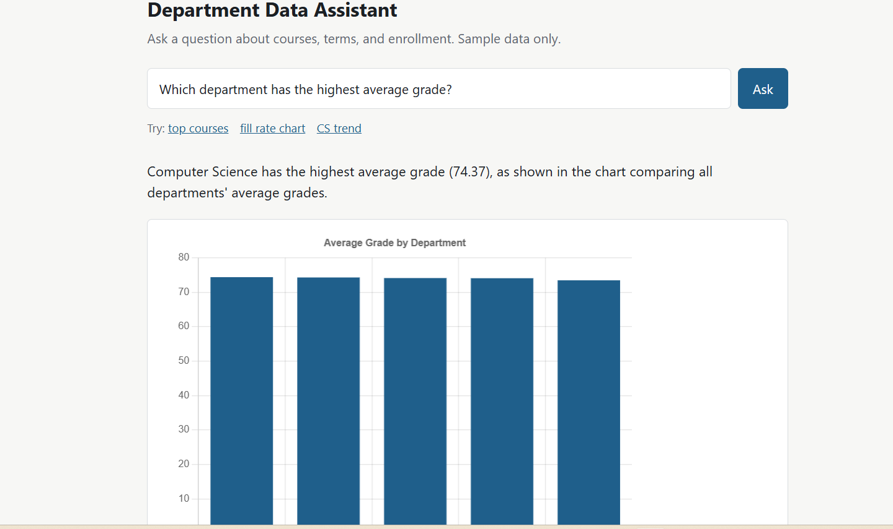

# Department Data Assistant

A Flask web app where an LLM agent (Cohere API, tool calling) answers plain-English questions about a
**synthetic** university database. The model chooses between three tools, our code runs them with
safety checks, and the app shows the answer, a table, an optional chart, and a CSV download.

## Run it

```bash
python -m venv .venv
source .venv/bin/activate        # Windows: .venv\Scripts\activate
pip install -r requirements.txt
cp .env.example .env             # then paste your Cohere API key into .env
python seed_data.py              # creates university.db (about 900 sections, synthetic)
python app.py                    # open http://127.0.0.1:5000
```

## How the agent works

1. The question goes to the model along with the tool list (`get_schema`, `query_data`, `make_chart`).
2. If the model asks for a tool, `agent.py` runs it and sends the result back.
3. The loop repeats (maximum 6 steps) until the model answers in plain text.

## Safety and responsible-AI controls

| Control | Where |
|---|---|
| Read-only database connection (`mode=ro`) | `db_tools.py` |
| SQLite authorizer allows SELECT operations only | `db_tools.py` |
| Single-statement SELECT/WITH check, forbidden keywords rejected | `db_tools.py` |
| 200-row limit and 3-second query timeout | `db_tools.py` |
| 6-step cap on the agent loop, 500-character question cap | `agent.py`, `app.py` |
| Audit log of every question and tool call | `logs/audit.jsonl` |
| Synthetic data only; system prompt forbids requesting personal data | `seed_data.py`, `agent.py` |
| API key kept in `.env`, never sent to the browser | `.env.example` |

Known limits: the model writes the SQL itself, so a wrong query can return a wrong answer
(the checks stop unsafe queries, not incorrect ones). That is why `eval_agent.py` exists.

## Evaluate it

```bash
python eval_agent.py
```

Runs 15 questions whose correct answers are computed from the database with hand-written SQL, then
prints the pass rate and average response time. Record your numbers here after running:

- Pass rate: __ / 15
- Average response time: __ s
- Model: command-a-plus-05-2026

## Ideas for next steps

- Keep conversation history so follow-up questions work.
- Add a second data source (a REST API) as another tool.
- Add per-IP rate limiting before deploying publicly.
